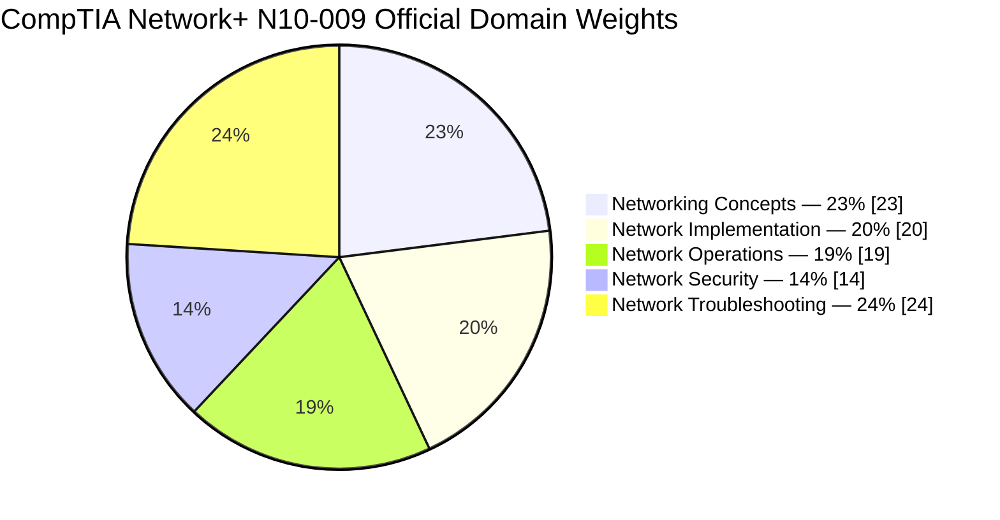
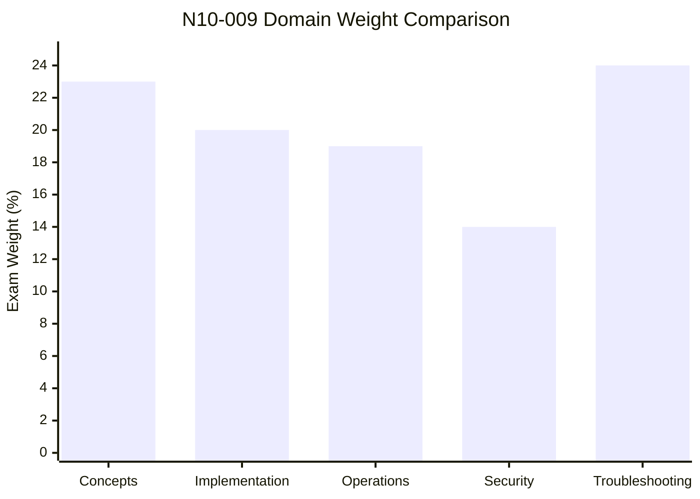
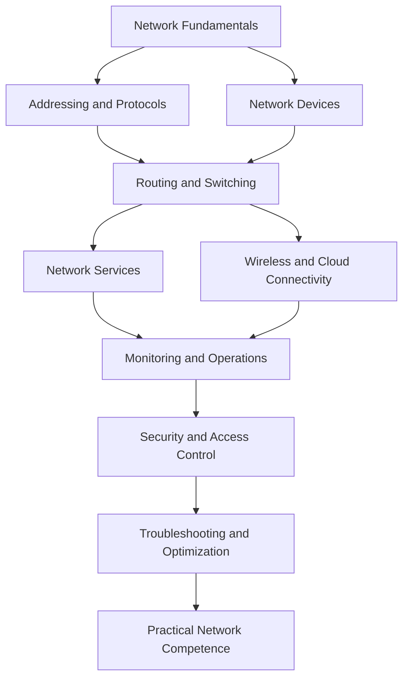
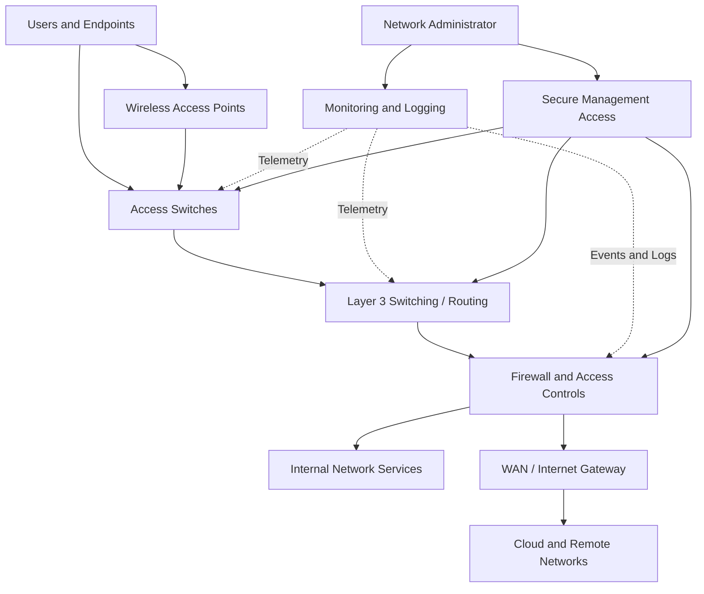
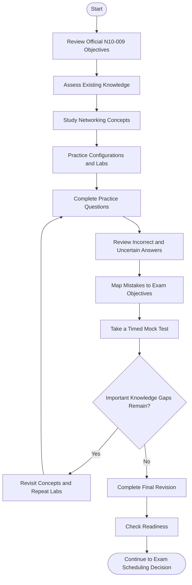
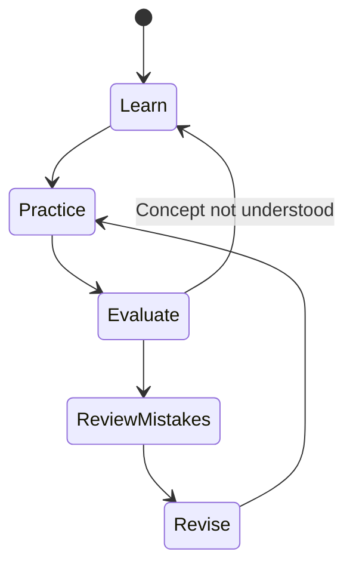
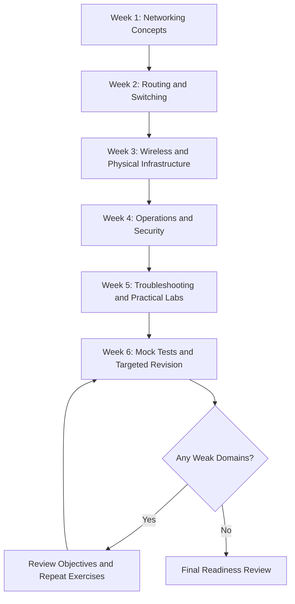
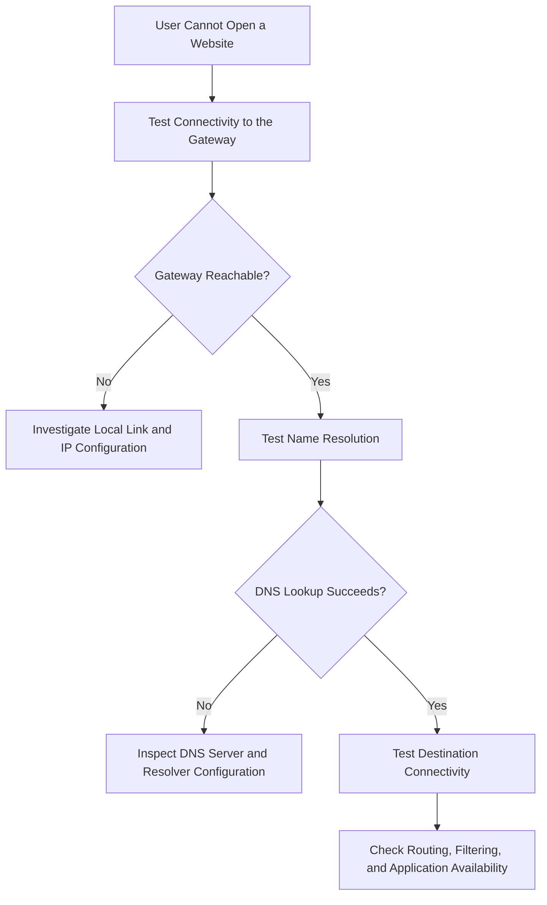

# CompTIA Network+ N10-009 Study Guide

A practical, structured study guide for the **CompTIA Network+ N10-009 certification exam**. This repository brings together networking fundamentals, implementation, network operations, security, troubleshooting, visual diagrams, hands-on exercises, original practice questions, and a step-by-step study roadmap.

The goal is to build networking knowledge that can be applied to realistic technical situations—not simply memorize definitions.

---

## Table of Contents

- [About CompTIA Network+](#about-comptia-network)
- [Who Should Use This Guide?](#who-should-use-this-guide)
- [Exam Overview](#exam-overview)
- [Official Exam Domains and Weightings](#official-exam-domains-and-weightings)
- [Core Skills to Develop](#core-skills-to-develop)
- [Network Architecture Overview](#network-architecture-overview)
- [Certification Preparation Flowchart](#certification-preparation-flowchart)
- [The Continuous Study Cycle](#the-continuous-study-cycle)
- [Step-by-Step Study Strategy](#step-by-step-study-strategy)
- [Suggested Six-Week Study Roadmap](#suggested-six-week-study-roadmap)
- [Hands-On Labs and Practical Exercises](#hands-on-labs-and-practical-exercises)
- [Practice Questions and Mock Tests](#practice-questions-and-mock-tests)
- [Common Preparation Mistakes](#common-preparation-mistakes)
- [Troubleshooting Decision Process](#troubleshooting-decision-process)
- [Career Relevance](#career-relevance)
- [Frequently Asked Questions](#frequently-asked-questions)
- [Official and Additional Resources](#official-and-additional-resources)
- [About CertsGate](#about-certsgate)

---

## About CompTIA Network+

CompTIA Network+ is a vendor-neutral networking certification designed to assess practical knowledge of network connectivity, infrastructure, services, operations, security, and troubleshooting.

The N10-009 exam corresponds to the Network+ V9 objectives. Its subject matter extends beyond remembering networking terminology. Candidates should understand how network components interact, recognize common configuration problems, select suitable technologies, and troubleshoot connectivity or performance issues systematically.

The official objectives cover wired and wireless networking, routing and switching, cloud and virtual networking, network documentation, monitoring, disaster recovery, security controls, and diagnostic tools.

This guide follows a practical learning approach:

**Understand the concepts → Configure and observe → Practice scenarios → Analyze mistakes → Revisit weak areas → Assess readiness.**

## Who Should Use This Guide?

This repository is useful for:

- IT support professionals building stronger networking fundamentals.
- Aspiring network administrators and infrastructure technicians.
- Students learning routing, switching, IP addressing, and network services.
- IT professionals preparing for the CompTIA Network+ N10-009 exam.
- Learners who understand basic networking terms but need more troubleshooting practice.

CompTIA's exam objectives recommend a minimum of 9–12 months of experience in the IT networking field. This is a recommendation, not a claim that every candidate must have identical experience.

Beginners can use the guide as a learning roadmap, but should spend additional time on basic computer networking, IP addressing, and command-line tools before moving into advanced scenarios.

## Exam Overview

| Item | Details |
|---|---|
| Certification | CompTIA Network+ |
| Exam code | N10-009 |
| Exam series | Network+ V9 |
| Exam objectives | Five official domains |
| Maximum questions | 90 |
| Question types | Multiple-choice and performance-based |
| Exam duration | 90 minutes |
| Recommended experience | 9–12 months in IT networking |
| Official exam information | [CompTIA Network+](https://www.comptia.org/en-us/certifications/network) |
| Official objectives | [N10-009 Exam Objectives PDF](https://comptiacdn.azureedge.net/webcontent/docs/default-source/exam-objectives/comptia-network-n10-009-exam-objectives-%284-0%29-%281%29.pdf) |

Check the official CompTIA website for the latest exam availability, policies, and published requirements before scheduling your exam.

## Official Exam Domains and Weightings

The official N10-009 objectives divide the exam into five domains. Their published percentages are useful for planning study time, but they should not replace your own assessment of weak areas.

| Domain | Official Weight |
|---|---:|
| 1.0 Networking Concepts | 23% |
| 2.0 Network Implementation | 20% |
| 3.0 Network Operations | 19% |
| 4.0 Network Security | 14% |
| 5.0 Network Troubleshooting | 24% |
| **Total** | **100%** |

### Official Domain Weight Distribution

### Domain Weight Comparison

The following chart uses the same official percentages shown in the table above.

### What to Study in Each Domain

#### 1. Networking Concepts — 23%

Focus on:

- OSI and TCP/IP models.
- Network appliances and their functions.
- Cloud connectivity and virtual networking.
- Common ports, protocols, services, and traffic types.
- Transmission media, transceivers, and connectors.
- Network topologies and architectures.
- IPv4 addressing and subnetting.
- Modern networking concepts such as SD-WAN, VXLAN, zero trust, SASE, and infrastructure as code.

#### 2. Network Implementation — 20%

Study routing technologies, route selection, VLANs, trunking, spanning tree, link aggregation, wireless technologies, and physical network installation.

Practice identifying the correct configuration or technology for a given network requirement.

#### 3. Network Operations — 19%

Learn how network teams document, monitor, maintain, and recover infrastructure.

Important subjects include network diagrams, IP address management, configuration baselines, SNMP, logs, packet captures, disaster recovery, DHCP, DNS, time services, and remote management.

#### 4. Network Security — 14%

Understand basic network security principles, common attacks, device hardening, access control, segmentation, authentication, secure remote access, and defensive network configurations.

Do not skip this domain because its percentage is lower than the others. Security concepts also affect implementation and troubleshooting scenarios.

#### 5. Network Troubleshooting — 24%

This domain has the largest published weight.

Practice diagnosing cabling faults, interface problems, routing and switching issues, IP configuration errors, DNS and DHCP failures, wireless interference, congestion, latency, packet loss, and other performance problems.

Know what common diagnostic tools can establish—and what their results cannot prove.

---

## Core Skills to Develop

Use this skills map as an independent study overview, not as an additional official exam blueprint.

A useful learning milestone is being able to explain why a configuration works, recognize when it fails, and identify the next diagnostic step.

## Network Architecture Overview

The following is an illustrative enterprise network. It demonstrates how users, access infrastructure, routing, security controls, services, and external connectivity can relate to one another. It is not an official CompTIA architecture diagram.

### Understand the Traffic Path

When a user cannot reach an application, investigate the path instead of assuming the application itself is faulty.

1. Verify the endpoint's physical or wireless connection.
2. Check IP address, subnet mask, default gateway, and DNS configuration.
3. Test connectivity to the local gateway.
4. Check routing and relevant switching configuration.
5. Investigate firewall rules and access controls.
6. Test name resolution and application reachability.
7. Review logs and monitoring data for additional evidence.

The exact sequence depends on the symptoms and the network design.

## Certification Preparation Flowchart

Use this process to organize your N10-009 preparation from the first review through final revision.

A low score should lead to targeted review rather than endless repetition of the same questions. Identify the missing concept, revisit the relevant material, and test whether you can apply it in a new scenario.

## The Continuous Study Cycle

Networking knowledge becomes more reliable when learning and practice reinforce one another.

This is an iterative process. A candidate might understand DNS theory but still struggle to diagnose a name-resolution problem. Practical testing exposes that gap and gives the next study session a clear purpose.

## Step-by-Step Study Strategy

### Step 1: Start With the Official Objectives

Download the N10-009 exam objectives from CompTIA. Read every domain and turn the numbered objectives into a checklist.

Mark each item as:

- **Not started:** I have not studied this topic.
- **Learning:** I understand some of it but need more work.
- **Practiced:** I have completed an exercise or scenario.
- **Ready to explain:** I can explain the concept and apply it without relying on memorized answers.

### Step 2: Build Networking Fundamentals

Study IP addressing, subnetting, ports, protocols, OSI layers, transmission media, network devices, and common services.

For example, do not only memorize that DNS resolves names. Understand how a client uses DNS, what a failed lookup looks like, and how to distinguish name-resolution problems from general connectivity problems.

### Step 3: Practice Routing, Switching, and Wireless

Learn how VLANs separate broadcast domains, how routers select paths, and how wireless channel selection and interference affect connectivity.

Use a network simulator or lab environment to observe configurations and their consequences.

### Step 4: Learn Operations and Security

Practice reading network diagrams, reviewing logs, documenting changes, checking monitoring data, and applying access controls. Understand why configuration backups, change management, and disaster recovery procedures matter.

### Step 5: Troubleshoot Methodically

Use a repeatable process:

1. Identify the problem.
2. Establish a probable cause.
3. Test the theory.
4. Create a plan and implement the solution.
5. Verify full functionality and implement preventive measures where appropriate.
6. Document findings, actions, and results.

### Step 6: Use Practice Questions to Find Gaps

Complete original practice questions after studying the relevant concepts. Review every incorrect answer and every correct answer that involved guessing.

A practice score is useful only when you understand what it reveals about your knowledge.

### Step 7: Revise and Assess Readiness

Return to the official objectives, revisit weak topics, repeat relevant labs, and use timed mock tests to assess your ability to apply knowledge under time constraints.

---

## Suggested Six-Week Study Roadmap

This is an independent planning suggestion, not an official CompTIA schedule. Adjust it to your existing experience and available study time.

| Week | Main Focus | Suggested Deliverable |
|---|---|---|
| 1 | Networking concepts, protocols, addressing | Explain core concepts and solve subnetting exercises |
| 2 | Routing, switching, VLANs | Build and test a small logical network |
| 3 | Wireless, cables, connectors, installation | Compare technologies and diagnose physical-layer faults |
| 4 | Operations, monitoring, security | Review logs, documentation, and basic security configurations |
| 5 | Troubleshooting | Complete mixed technical scenarios and diagnostic labs |
| 6 | Mock tests and weak-area review | Analyze results and revise every unresolved objective |

The schedule is a guide, not a deadline. If subnetting or troubleshooting remains difficult, spend more time there rather than moving forward just to finish the calendar.

## Hands-On Labs and Practical Exercises

Hands-on practice makes abstract networking concepts easier to remember. Use an authorized lab, simulator, or personal test environment. Avoid making changes to networks you do not own or administer.

| Exercise | What to Practice | What to Verify |
|---|---|---|
| IP configuration | Inspect addresses, subnet masks, gateways, and DNS | Confirm the endpoint's configuration is appropriate |
| Connectivity testing | Use `ping` and `traceroute` or `tracert` | Identify where connectivity appears to fail |
| DNS troubleshooting | Use `nslookup` or `dig` | Compare successful and unsuccessful name lookups |
| Packet inspection | Capture traffic with Wireshark or another analyzer | Identify protocols and relevant packet exchanges |
| VLAN planning | Design separate user and management VLANs | Explain segmentation and required routing |
| DHCP investigation | Examine leases, scopes, and gateway settings | Identify common address-assignment problems |
| Wireless diagnosis | Inspect signal strength and channel interference | Explain potential causes of unreliable connections |
| Network documentation | Draw a logical diagram and inventory devices | Record dependencies and configuration details |
| Monitoring | Review available interface metrics and logs | Identify errors, utilization changes, or unusual events |
| Security hardening | Review unused services, ports, and access rules | Explain the effect of each proposed control |

### Example: Diagnose a DNS Failure

This is an illustrative decision path. Real incidents may require parallel checks or additional evidence.

---

## Practice Questions and Mock Tests

Practice questions help identify knowledge gaps, but they should not replace the official objectives, technical study, or hands-on work.

Use this review method:

**Answer → Review → Understand → Identify Weak Area → Revisit Material → Try Again**

CertsGate provides independent supplementary preparation material that learners can use alongside their primary study resources:

**[Explore CompTIA Network+ N10-009 preparation on CertsGate](https://certsgate.com/exams/comptia/n10-009)**

Use practice questions to evaluate your understanding of concepts such as routing, addressing, network services, monitoring, security, and troubleshooting. Treat each explanation as an opportunity to learn the underlying principle.

### Original Sample Questions

The following questions are written for this guide. They are illustrative study questions, not official or actual CompTIA exam questions.

**Question 1: DNS**

A workstation can reach a server using its IP address but cannot access it using its hostname. Which service should you investigate first?

A. DHCP  
B. DNS  
C. NTP  
D. SNMP

**Answer: B — DNS.** DNS resolves hostnames to IP addresses. Successful access by IP address suggests that basic connectivity may be working, although additional testing is needed to confirm the cause.

**Question 2: VLANs**

What is a primary purpose of placing different groups of devices in separate VLANs?

A. To eliminate the need for routing  
B. To create logical network segmentation  
C. To guarantee internet availability  
D. To encrypt all traffic automatically

**Answer: B — To create logical network segmentation.** VLANs separate Layer 2 broadcast domains. Communication between VLANs generally requires Layer 3 routing and may be controlled by security policies.

**Question 3: Network Troubleshooting**

A user reports intermittent connectivity, and a cable tester identifies a wiring fault. What should you do next?

A. Replace the DNS server immediately  
B. Ignore the result and restart the application  
C. Correct the cabling fault and verify connectivity  
D. Change the user's password

**Answer: C — Correct the cabling fault and verify connectivity.** Address the confirmed physical-layer issue, then test whether the original symptoms have been resolved.

**Question 4: Network Monitoring**

Which technology is commonly used to collect network-device management information and monitor device status?

A. SNMP  
B. FTP  
C. SMTP  
D. TFTP

**Answer: A — SNMP.** Simple Network Management Protocol supports the exchange of management information between network devices and monitoring systems.

**Question 5: Troubleshooting Tools**

Which tool is most directly suited to examining packet-level network traffic?

A. Packet analyzer  
B. Spreadsheet editor  
C. Text formatter  
D. File compression utility

**Answer: A — Packet analyzer.** Tools such as Wireshark can capture and inspect packets, helping administrators investigate protocol behavior and communication problems.

### How to Review Your Results

For every question, record:

- The objective or concept being tested.
- Why the correct answer fits the scenario.
- Why the alternatives are less suitable.
- Whether the mistake came from missing knowledge, misreading the scenario, or choosing a solution too quickly.
- What exercise or reading will help prevent the same mistake.

Use mock tests to practice pacing and identify weak domains. Do not treat repeated exposure to the same questions as proof that you are ready.

---

## Common Preparation Mistakes

### Memorizing Ports Without Understanding Their Use

Learn common ports and protocols, but also understand what services use them and how those services can fail.

### Skipping Subnetting

Practice subnet masks, network and broadcast addresses, host ranges, CIDR notation, and basic IPv4 planning until the calculations become familiar.

### Ignoring Performance-Based Practice

Reading about a configuration is not the same as applying it. Use labs and scenario-based exercises to strengthen practical reasoning.

### Guessing Without Reviewing

A correct guess can conceal a knowledge gap. Review uncertain answers even when your score is high.

### Using Outdated Study Material

Compare third-party content with the current N10-009 objectives. Older Network+ exam versions may contain useful fundamentals, but their coverage and emphasis may differ.

### Overlooking Network Troubleshooting

Troubleshooting accounts for 24% of the published exam weighting. Practice a structured diagnostic method and learn to interpret the results of common tools.

### Relying on a Single Resource

Combine official objectives, reliable technical documentation, hands-on work, and independent practice materials. No single study resource can guarantee readiness.

---

## Troubleshooting Decision Process

When diagnosing a network problem, select the next action based on evidence rather than habit.

| Symptom | Initial Checks | Possible Areas to Investigate |
|---|---|---|
| No network connection | Link status, Wi-Fi association, IP configuration | Cabling, wireless access, interface, DHCP |
| Can reach gateway but not remote networks | Routing table, traceroute, gateway configuration | Routing, ACLs, firewall rules, upstream connectivity |
| IP works but hostname fails | DNS lookup and resolver configuration | DNS server, records, search suffixes |
| Slow connection | Latency, packet loss, interface utilization | Congestion, duplex issues, bottlenecks, wireless interference |
| Intermittent wireless access | Signal strength, channel utilization, roaming | Interference, coverage, channel planning, client configuration |
| Devices receive incorrect addresses | DHCP leases, scope, relay configuration | DHCP scope exhaustion, exclusions, relay or server settings |

These are starting points rather than definitive diagnoses. Validate suspected causes before changing production configurations.

## Career Relevance

The knowledge covered by Network+ can support learning and work in areas such as:

- IT support and technical service desks.
- Network administration.
- Infrastructure operations.
- Network troubleshooting and monitoring.
- Junior systems and network engineering.
- Security operations that require networking fundamentals.

The certification is one way to demonstrate foundational networking knowledge. Practical experience, communication, documentation, and the ability to diagnose real problems remain important parts of professional development.

---

## Frequently Asked Questions

### What is the CompTIA Network+ N10-009 exam?

N10-009 is the exam code for CompTIA Network+ V9. Its objectives cover networking concepts, implementation, operations, security, and troubleshooting.

### How long is the N10-009 exam?

The published exam duration is 90 minutes, with a maximum of 90 questions. CompTIA lists multiple-choice and performance-based question types. Check the official exam page for current details.

### Which N10-009 domain should I study first?

Start with networking concepts if you need to strengthen the fundamentals. Use the official percentages to plan your effort, but prioritize individual topics according to your diagnostic results and practical experience.

### Are practice questions enough to prepare?

Practice questions are useful for checking understanding and identifying weak areas, but they should be combined with official objectives, concept study, practical exercises, and mistake review.

### Should I use labs when preparing for Network+?

Yes. Labs help connect theory with configuration and troubleshooting. Focus on IP addressing, DNS, DHCP, routing, switching, wireless connectivity, packet inspection, and diagnostic tools.

### Is this repository an official CompTIA resource?

No. This is an independent educational study guide. CompTIA's official website and exam objectives remain the authoritative sources for exam information.

### Where can I find additional N10-009 preparation material?

Start with the official CompTIA resources listed below. You can also explore independent study guides and practice material from [CertsGate](https://certsgate.com/exams/comptia/n10-009) as a supplement to your learning.

---

## Official and Additional Learning Resources

Use official resources to confirm the exam blueprint and current policies. Use additional technical references to deepen your understanding and build practical skills.

### Official CompTIA Resources

- [CompTIA Network+ Certification](https://www.comptia.org/en-us/certifications/network) — certification information and official exam resources.
- [CompTIA Network+ N10-009 Exam Objectives](https://comptiacdn.azureedge.net/webcontent/docs/default-source/exam-objectives/comptia-network-n10-009-exam-objectives-%284-0%29-%281%29.pdf) — exam domains, objectives, and recommended experience.
- [CompTIA Exam Policies](https://www.comptia.org/en-us/resources/test-policies) — review current testing policies and requirements.
- [CompTIA Training](https://www.comptia.org/en-us/training) — explore available training options.

### Technical Learning Resources

- [Cisco Networking Academy](https://www.netacad.com/) — networking education and learning opportunities.
- [Wireshark Documentation](https://www.wireshark.org/docs/) — packet analysis and troubleshooting references.
- [Internet Engineering Task Force (IETF)](https://www.ietf.org/) — standards and technical publications relevant to internet protocols.
- [RFC Editor](https://www.rfc-editor.org/) — published RFC documents describing internet protocols and related standards.
- [CertsGate Network+ N10-009 Preparation](https://certsgate.com/exams/comptia/n10-009) — independent supplementary preparation material.

Always verify exam details and objective coverage against the current CompTIA documentation. External learning resources may cover more or less than the specific exam requires.

---

## About CertsGate

[CertsGate](https://certsgate.com/) offers independent IT certification preparation resources, including exam-focused study material and practice questions.

For candidates preparing for CompTIA Network+ N10-009, supplementary practice can help reinforce networking concepts, test understanding, and identify topics that need further review.

A productive approach is to study the official objectives first, learn the relevant concepts, practice in a lab, and then use questions to check your understanding. Review mistakes carefully instead of relying on memorized answer patterns.
